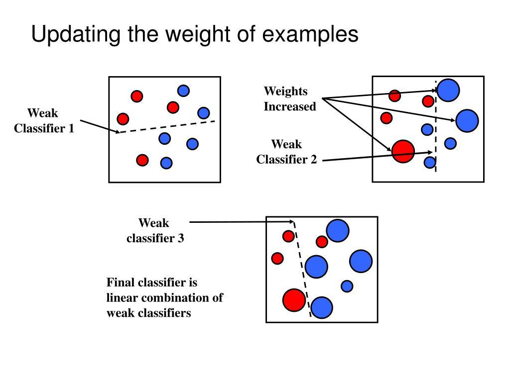

# Unsupervised Learning — K-Means Clustering

## 1. What is Unsupervised Learning?

Unsupervised learning is a type of machine learning where the dataset has no target labels provided to the algorithm. The algorithm tries to discover patterns or structure in the data.

Examples:
- Customer segmentation
- Grouping similar documents
- Discovering patterns in purchasing behavior

**Classification vs Clustering**
- Classification: learns to predict predefined classes using labeled data.
- Clustering: discovers groups from unlabeled data.

## 2. What is K-Means?

K-Means is an unsupervised learning algorithm that divides data into K clusters.

Each cluster is represented by a centroid, which is the mean of the points assigned to that cluster.

### Algorithm steps

1. Choose K, the number of clusters.
2. Initialize K centroids.
3. Assign each point to its nearest centroid.
4. Recalculate each centroid using the mean of its assigned points.
5. Repeat assignment and recalculation until convergence or the iteration limit.

### Conceptual diagram

```text
Unlabeled data
      |
      v
Choose K centroids
      |
      v
Assign each point to nearest centroid
      |
      v
Recalculate centroids
      |
      v
Repeat until convergence
      |
      v
Final clusters
```

## 3. Centroid calculation

The centroid is the mean of each feature across all points assigned to a cluster.

For points (100, 2), (200, 4), and (300, 6):

Centroid = ((100 + 200 + 300) / 3, (2 + 4 + 6) / 3)

Centroid = (200, 4)

## 4. Euclidean distance

K-Means commonly uses Euclidean distance to measure the distance between a point and a centroid.

For two points (x1, y1) and (x2, y2):

d = sqrt((x2 - x1)^2 + (y2 - y1)^2)

Plain text:
distance = square root of [(x2 − x1)² + (y2 − y1)²]

K-Means assigns each point to its nearest centroid.

## 5. K-Means objective function

K-Means minimizes the sum of squared distances between each point and its assigned centroid.

J = sum over clusters k, and points xi in cluster Ck, of ||xi − μk||²

Where:
- K = number of clusters
- Ck = points assigned to cluster k
- xi = a data point
- μk = centroid of cluster k
- J = total within-cluster sum of squared distances

In scikit-learn, this quantity is called **inertia**.

Lower inertia means points are closer to their assigned centroids. However, inertia generally decreases as K increases, so inertia alone cannot determine the best K.

## 6. Python practical

File: `machine_learning/06_unsupervised_learning/01_kmeans_clustering.py`

```python
import matplotlib.pyplot as plt
from sklearn.datasets import make_blobs
from sklearn.cluster import KMeans

# Generate sample data
X, _ = make_blobs(
    n_samples=300,
    centers=4,
    cluster_std=0.75,
    random_state=42
)

# Train K-Means
model = KMeans(
    n_clusters=4,
    random_state=42,
    n_init=10
)

# Fit the model and obtain cluster assignments
labels = model.fit_predict(X)

# Get centroids
centroids = model.cluster_centers_

print("First 10 cluster labels:", labels[:10])
print("Centroids:\n", centroids)
print("Inertia:", model.inertia_)

# Plot clusters
plt.scatter(X[:, 0], X[:, 1], c=labels, s=30)
plt.scatter(
    centroids[:, 0],
    centroids[:, 1],
    marker="X",
    s=250,
    edgecolors="black",
    label="Centroids"
)

plt.title("K-Means Clustering")
plt.xlabel("Feature 1")
plt.ylabel("Feature 2")
plt.legend()
plt.show()
```

### Important code concepts

- `make_blobs()` generates synthetic sample points for practice.
- `n_clusters=4` asks K-Means to find four clusters.
- `random_state=42` makes the randomized process reproducible.
- `n_init=10` tries multiple centroid initializations.
- `fit_predict(X)` fits the model and returns a cluster ID for each point.
- `cluster_centers_` returns the learned centroids.
- `inertia_` returns the total within-cluster squared distance.

The generated dataset has four underlying groups, but K-Means is given only X, not the true labels. Cluster IDs such as 0, 1, 2, and 3 are arbitrary identifiers, not rankings.

## 7. Choosing K — Elbow Method

The elbow method tests different K values and plots inertia against K.

Procedure:
1. Fit K-Means for K = 1, 2, 3, ..., 10.
2. Record inertia for each K.
3. Plot K on the x-axis and inertia on the y-axis.
4. Look for the point where the curve starts flattening.

That point is called the elbow.

The elbow suggests a reasonable trade-off between compact clusters and too many clusters. It is a heuristic; some datasets do not have a clear elbow.

Example code:

```python
import matplotlib.pyplot as plt
from sklearn.cluster import KMeans

inertias = []
k_values = range(1, 11)

for k in k_values:
    model = KMeans(
        n_clusters=k,
        random_state=42,
        n_init=10
    )
    model.fit(X)
    inertias.append(model.inertia_)

plt.plot(k_values, inertias, marker="o")
plt.xlabel("Number of clusters (K)")
plt.ylabel("Inertia")
plt.title("Elbow Method")
plt.xticks(list(k_values))
plt.show()
```

## 8. Silhouette Score

The silhouette score evaluates both how close a point is to its own cluster and how separated it is from the nearest alternative cluster.

s = (b − a) / max(a, b)

Where:
- a = average distance from a point to other points in its own cluster
- b = average distance to points in the nearest other cluster

Interpretation:
- Close to +1: well-separated cluster assignment
- Around 0: point is near a cluster boundary or clusters overlap
- Close to −1: point may fit better in another cluster

A higher average silhouette score generally suggests better-separated, more cohesive clusters. It is not classification accuracy.

Example:

```python
from sklearn.metrics import silhouette_score
from sklearn.cluster import KMeans

for k in range(2, 11):
    model = KMeans(
        n_clusters=k,
        random_state=42,
        n_init=10
    )

    labels = model.fit_predict(X)
    score = silhouette_score(X, labels)

    print(f"K = {k}, Silhouette Score = {score:.3f}")
```

Silhouette score requires at least two clusters and fewer clusters than data points.

## 9. Feature Scaling

K-Means uses distances. If features have very different numerical ranges, a large-scale feature can dominate distance calculations.

Standardization formula:

z = (x − μ) / σ

Plain text:
scaled value = (original value − feature mean) / feature standard deviation

Where:
- x = original feature value
- μ = feature mean
- σ = feature standard deviation
- z = standardized value

Example:

```python
from sklearn.preprocessing import StandardScaler
from sklearn.cluster import KMeans
from sklearn.metrics import silhouette_score

scaler = StandardScaler()
X_scaled = scaler.fit_transform(X)

model = KMeans(
    n_clusters=4,
    random_state=42,
    n_init=10
)

labels = model.fit_predict(X_scaled)

print("Silhouette score:", silhouette_score(X_scaled, labels))
print("Scaled centroids:\n", model.cluster_centers_)
```

Scale features when their units or ranges would otherwise distort distances. Scaling is not guaranteed to improve every result; it changes the distance calculation. For real-world evaluation, fit the scaler on training data and use the same fitted scaler to transform future data.

## 10. Limitations of K-Means

1. **K must be chosen:** The algorithm requires the number of clusters in advance.
2. **Cluster shapes:** It works best for compact, roughly spherical groups and can struggle with curved or nested clusters.
3. **Outliers:** Extreme points can pull centroids because centroids are means.
4. **Initialization:** Different initial centroids can produce different results. Multiple initializations help.
5. **Numeric data:** Ordinary K-Means requires numerical feature vectors and is not directly suitable for raw categorical features.
6. **Scaling:** Features with large numerical ranges can dominate distances.
7. **No guaranteed global optimum:** The algorithm can converge to a local solution.

## 11. Quick revision

- K-Means is an unsupervised clustering algorithm.
- K is the number of clusters.
- A centroid is the mean of the points in a cluster.
- Points are assigned to their nearest centroid.
- Inertia measures total within-cluster squared distance.
- The elbow method helps choose K by examining the inertia curve.
- Silhouette score measures cohesion and separation.
- Feature scaling is often important for distance-based clustering.
- Cluster IDs are arbitrary labels, not predicted categories.

**Current status:** K-Means — Learning. Mark it Practiced after running the code, inspecting the plot, and experimenting with at least two different K values.